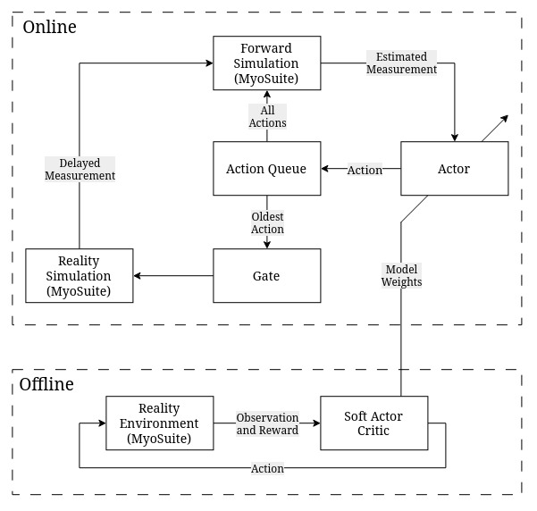

# Faulty Action Gating in Over-Actuated Musculoskeletal Models

<p align="center">
  <a href="https://doi.org/10.5281/zenodo.23458616"></a>
</p>


This repository contains the simulation code for studying whether faulty action gating can reproduce the motor symptoms of Parkinson's disease in biomechanically plausible, over-actuated musculoskeletal models. The implementation combines MyoSuite environments, Soft Actor Critic (SAC) reinforcement learning, delayed proprioceptive feedback, forward simulation, and a disease model that attenuates the actions applied to the physical environment while leaving the internal model unchanged.

> **Research status:** This repository accompanies the BMES 2026 research abstract and is provided for research and reproducibility purposes. The DOI and final publication details will be added when they are available.

## Overview

Parkinson's disease is associated with dopamine depletion in the basal ganglia, but the mechanism connecting that dysfunction to both tremor and bradykinesia remains an open question. The faulty action-gating hypothesis proposes that excessive inhibition of the ventral lateral anterior nucleus of the thalamus reduces the amplitude of intended motor signals. The brain nevertheless predicts the consequences of the intended, ungated signals. With delayed proprioceptive feedback, the mismatch between the predicted and implemented dynamics can produce repeated under- and overcorrections, resembling Parkinsonian tremor and slowed movement.

This project extends earlier one-degree-of-freedom torque-wrist results to higher-dimensional, over-actuated musculoskeletal systems:

- **Arm:** the standard 1-DoF, 6-muscle `myoElbow` environment, based on OpenSim's default `arm26` model, for studying bradykinesia.
- **Wrist:** a modified 3-DoF, 39-muscle `myoHand` environment containing the muscles from the elbow to the phalanges, for isolating wrist tremor.

## Model Architecture

The system has an offline learning phase and an online disease-simulation phase. During offline training, SAC learns reaching behavior from observations, rewards, and actions in a MyoSuite environment. During online evaluation, the actor selects actions from an estimated state. Those actions are buffered and used by two parallel simulations:

1. The **reality simulation** receives the oldest action after it passes through the disease gate.
2. The **forward simulation** uses the current state and buffered actions to predict the future state without gating, representing the brain's internal model.
3. The resulting delayed measurement is returned to the controller, closing the feedback loop.

The gate value is reduced from 1 to 0 to represent increasing disease dysfunction. A value of 1 leaves the action unchanged; lower values attenuate the action applied to the reality simulation while the internal forward model continues to assume that the intended action was applied.



*Figure 1. Offline SAC training supplies the actor and model weights used by the online delayed-feedback loop. The online loop separates the MyoSuite reality simulation from the ungated forward simulation and applies the gate to the oldest buffered action.*

## Research Abstract

### Faulty Action Gating Reproduces Parkinsonian Tremor and Bradykinesia in Over-Actuated Musculoskeletal Models

#### Introduction

While it is believed that depletion of dopamine in the basal ganglia causes Parkinson's disease motor symptoms, the exact mechanism behind how this dysfunction produces both tremor and bradykinesia remains unclear. Recent work suggests a single model to explain both behaviors by faulty action gating that causes a mismatch between implemented dynamics and internal models. Dopamine loss causes excessive basal ganglia inhibition of the ventral lateral anterior nucleus of the thalamus. This inhibition causes a dysfunction in the gating mechanism, reducing the amplitude of intended signals. However, the brain still expects the intended signals to be applied to the body and predicts what will happen based on that false assumption. When the proprioceptive feedback from the extremity reaches the brain after beginning movement, the brain will attempt to correct with a still-altered signal. This produces a cycle of under- and overcorrections that is identical to tremor and the slowness of movement characteristic of Parkinson's disease. Previous work shows this behavior on a one degree-of-freedom (DoF) torque wrist. This work aims to expand upon this result by raising the dimensionality of the models to a biomechanically plausible scale to determine whether these behaviors still exist. These new models use the musculoskeletal simulator MyoSuite (which borrows its models from OpenSim and its physics from MuJoCo), reinforcement learning (RL) models for the control model, and an implemented disease model consistent with the one described above.

#### Materials and Methods

This work applies two MyoSuite environments to evaluate model behavior: an arm environment for bradykinesia and a wrist environment for tremor. The arm model is the standard 1-DoF and 6-muscle myoElbow which rotates about the elbow and is based on OpenSim's default arm26 model. The wrist model is a modified myoHand model with 3-DoF and 39 muscles, including only muscles from the elbow to the phalanges, to better isolate wrist tremor. The model uses Soft Actor Critic (SAC) RL due to its training efficiency and ability to handle continuous action spaces. The control models are trained for a reaching task in each environment. The training utilizes the standard training weights action regulation, sparse, and solved as well as three non-standard weights action change, motion, and moving away. After the first quarter of the episode horizon, action change rewards reductions in muscle activation and penalizes increases in muscle activation. Motion penalizes all velocity and moving away penalizes only velocity misaligned with the target. Weights are tuned to produce characteristic healthy movements. Model predictive control captures how the brain's internal models overcome feedback delays. In this work, forward models are implemented as a direct simulation of the future state using the current state and buffered actions. The control action is chosen using the SAC model at every time step using the state estimate. Internal models are simulated using ungated actions, whereas the reality environment is simulated with gated actions. The gate value is reduced from one to zero to represent disease progression.

#### Results, Conclusions, and Discussions

Model simulations produce characteristic healthy and parkinsonian movements. The arm model showed lower peak velocities during reaching which signifies bradykinesia. It also showed a worsening of either over or undershoot depending on arm momentum within a trial. On some trials of the arm model, a tremor was observed between 5-6 Hz. The wrist model showed a characteristic parkinsonian tremor. The presence and characteristics of tremor depend on the severity of disease dysfunction. For this discussion, characteristic tremors are defined as oscillations in the range of 4-6 Hz having an amplitude greater than 0.25 mm. The highest incidence of characteristic tremor occurred toward the middle of the disease progression and eventually subsided to either higher frequency tremor or to convergence outside the best reward region. The peak tremor incidence and amplitude occurred at gate value 0.4 and appears in 4 of 5 of the trials. The roles of reward weights in the control model training may be somewhat analogous to the actions of key neurotransmitters. The standard weights of sparse and solved may correspond to dopamine as they are the primary impetus of the control model to move towards the target. The standard weight action regulation may correspond to norepinephrine as it modulates the willingness of the control model to have high muscle activation. The additional weights action change, motion, and moving away may correspond to serotonin as it modulates the control model's willingness towards change. When these weights are balanced, healthy motion is observed and Parkinson's disease characteristics can be observed by changing the gate value. This work provides greater evidence that faulty gating may produce Parkinson's disease symptoms by applying the disease model to higher dimensional systems. Behavior previously captured in low-order model simulations is demonstrated in higher-order, multi-DoF, over-actuated musculoskeletal models.

## Installation

The package requires Python 3.10 or newer. MyoSuite and MuJoCo can be sensitive to platform and graphics-driver configuration; a virtual environment or Conda environment is recommended.

```bash
git clone https://github.com/Zoticus-Network/parkinsons-simulation.git
cd parkinsons-simulation
python -m venv .venv
source .venv/bin/activate
python -m pip install .
```

The package declares the following core dependencies:

- [PyTorch](https://pytorch.org/)
- [Stable-Baselines3](https://stable-baselines3.readthedocs.io/)
- [MyoSuite 2.12.2](https://github.com/MyoHub/myosuite)
- [MyoReachers](https://github.com/MyoHub/myoreachers)

## Usage

The primary implementation is `unstablefeedback.neural_delays.NeuralDelayWrapper`. The wrapper maintains a delayed action buffer and a headless copy of the environment for forward simulation. A minimal smoke test is available in `tests/test_wrapper.py` and can be run with:

```bash
python tests/test_wrapper.py
```

To request MuJoCo rendering where the local display configuration supports it:

```bash
python tests/test_wrapper.py --render
```

The example creates the random wrist-reaching environment with a 90 ms neural delay and a 2 second episode:

```python
import myoreachers
from myosuite.utils import gym

from unstablefeedback.neural_delays import NeuralDelayWrapper

env = NeuralDelayWrapper(
	gym.make("myoreachersWristRandom-v0", max_episode_steps=400),
	neural_delay=4,  # 90 ms at a 20 ms control step
	gravity_range=[0, 0],
	gravity_xyz=[0, 0, 0],
)
observation, info = env.reset()
for _ in range(100):
	observation, reward, terminated, truncated, info = env.step(
		env.action_space.sample()
	)
	if terminated or truncated:
		break
env.close()
```

The `b` parameter controls action gating. Use `b=1` for the ungated condition and reduce it toward `0` to simulate increasing action attenuation. The wrapper also supports randomized gravity and viscosity ranges at reset, which can be used to evaluate robustness across physical conditions.

## Future Work

This repository is an active research implementation. Future updates will add the configuration files, training scripts, and testing scripts needed to make the reported experiments fully reproducible. Trained SAC policies, exact experiment configurations, and the final DOI will also be added as the associated research release is finalized.

## Citation

Please cite the associated BMES 2026 poster paper when using this work. The complete citation and DOI will be added here after publication.

```text
Ward, Nathaniel, and Christopher Kelley. "Faulty Action Gating Reproduces
Parkinsonian Tremor and Bradykinesia in Over-Actuated Musculoskeletal Models."
BMES 2026 Research Abstract.
```

```bibtex
@software{Ward_parkinsons_simulation_2026,
	author = {Ward, Nathaniel and Kelley, Christopher},
	month = oct,
	title = {{Zoticus-Network/parkinsons-simulation: Parkinson's simulation v0.1.0-Alpha}},
	version = {v0.1.0},
	year = {2026}
}
```

## License

The software in this repository is released under the [MIT License](LICENSE).
The abstract herein, "Faulty Action Gating Reproduces Parkinsonian Tremor and Bradykinesia in Over-Actuated Musculoskeletal Models," is copyrighted by Nathaniel Ward and Christopher Kelley. Copyright 2026 Nathaniel Ward and Christopher Kelley.
